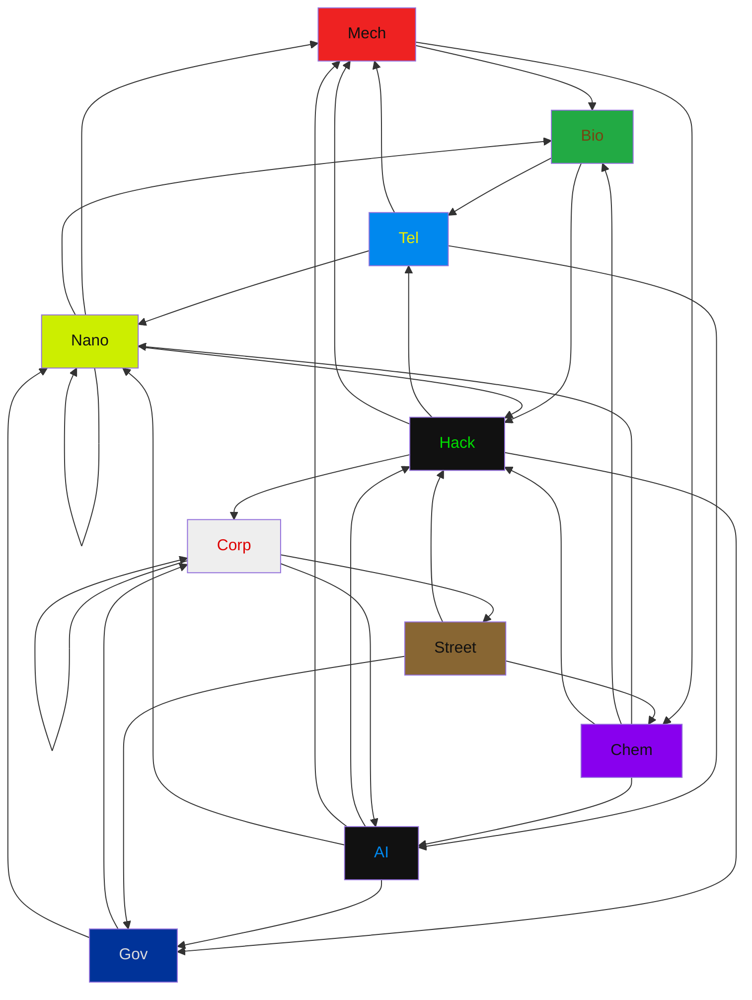

## Types Chart

| A \ D  |  Mech  |  Bio   |  Tel   |  Nano  |  Chem  |  Hack  |   AI   |  Corp  | Street |  Gov   |
| ------ | ------ | ------ | ------ | ------ | ------ | ------ | ------ | ------ | ------ | ------ |
|  Mech  |   .    |   X    |   .    |   .    |   X    |   .    |   .    |   .    |   .    |   .    |
|  Bio   |   .    |   .    |   X    |   .    |   .    |   X    |   .    |   .    |   .    |   .    |
|  Tel   |   X    |   .    |   .    |   X    |   .    |   .    |   X    |   .    |   .    |   .    |
|  Nano  |   X    |   X    |   .    |   X    |   .    |   X    |   .    |   .    |   .    |   .    |
|  Chem  |   .    |   X    |   .    |   X    |   .    |   X    |   X    |   .    |   .    |   .    |
|  Hack  |   X    |   .    |   X    |   .    |   .    |   .    |   .    |   X    |   .    |   X    |
|   AI   |   X    |   .    |   .    |   X    |   .    |   X    |   .    |   .    |   .    |   X    |
|  Corp  |   .    |   .    |   .    |   .    |   .    |   .    |   X    |   X    |   X    |   .    |
| Street |   .    |   .    |   .    |   .    |   X    |   X    |   .    |   .    |   .    |   X    |
|  Gov   |   .    |   .    |   .    |   X    |   .    |   .    |   .    |   X    |   .    |   .    |

## Type Stats

| Type | Weak To (Incoming) | Strong Against (Outgoing) | 3-Type Cycles |
| :--- | :--- | :--- | :---: |
| **`Mech`** | `Tel`, `Nano`, `Hack`, `AI` (4) | `Bio`, `Chem` (2) | **5** |
| **`Bio`** | `Mech`, `Nano`, `Chem` (3) | `Tel`, `Hack` (2) | **3** |
| **`Tel`** | `Bio`, `Hack` (2) | `Mech`, `Nano`, `AI` (3) | **4** |
| **`Nano`** | `Tel`, `Nano`, `Chem`, `AI`, `Gov` (5) | `Nano`, `Mech`, `Bio`, `Hack` (4) | **4** |
| **`Chem`** | `Mech`, `Street` (2) | `Nano`, `Bio`, `AI`, `Hack` (4) | **3** |
| **`Hack`** | `Bio`, `Nano`, `Chem`, `AI`, `Street` (5) | `Tel`, `Mech`, `Corp`, `Gov` (4) | **7** |
| **`AI`** | `Tel`, `Chem`, `Corp` (3) | `Hack`, `Mech`, `Nano`, `Gov` (4) | **4** |
| **`Corp`** | `Hack`, `Corp`, `Gov` (3) | `Corp`, `Street`, `AI` (3) | **4** |
| **`Street`** | `Corp` (1) | `Gov`, `Chem`, `Hack` (3) | **2** |
| **`Gov`** | `Hack`, `AI`, `Street` (3) | `Corp`, `Nano` (2) | **3** |

## Type Cycles

Found 13 3-type cycles:

- Mech -> Bio -> Tel -> Mech
- Mech -> Bio -> Hack -> Mech
- Mech -> Chem -> Nano -> Mech
- Mech -> Chem -> Hack -> Mech
- Mech -> Chem -> AI -> Mech
- Bio -> Tel -> Nano -> Bio
- Tel -> Nano -> Hack -> Tel
- Tel -> AI -> Hack -> Tel
- Nano -> Hack -> Gov -> Nano
- Hack -> Corp -> AI -> Hack
- Hack -> Corp -> Street -> Hack
- AI -> Gov -> Corp -> AI
- Corp -> Street -> Gov -> Corp
