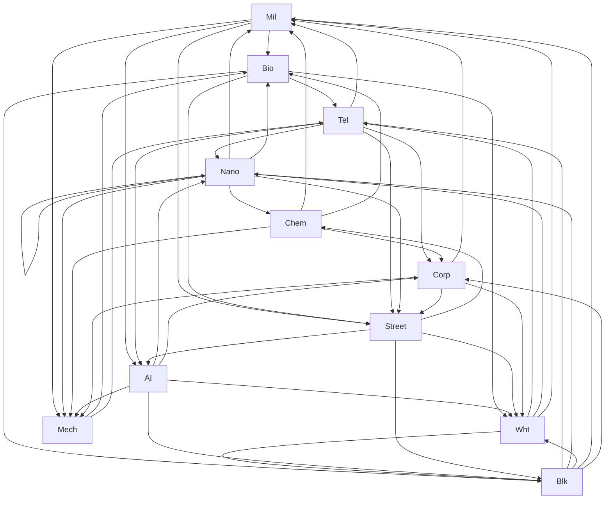

## Types Chart

| A \ D  |  Mil   |  Bio   |  Tel   |  Nano  |  Chem  |  Blk   |  Wht   |   AI   | Street |  Corp  |  Mech  |
| ------ | ------ | ------ | ------ | ------ | ------ | ------ | ------ | ------ | ------ | ------ | ------ |
|  Mil   |   .    |   X    |   .    |   .    |   .    |   .    |   .    |   X    |   X    |   .    |   X    |
|  Bio   |   .    |   .    |   X    |   .    |   .    |   X    |   X    |   .    |   X    |   .    |   .    |
|  Tel   |   X    |   .    |   .    |   X    |   .    |   .    |   .    |   X    |   X    |   X    |   .    |
|  Nano  |   X    |   X    |   .    |   X    |   X    |   .    |   .    |   .    |   X    |   .    |   X    |
|  Chem  |   X    |   X    |   .    |   .    |   .    |   .    |   .    |   .    |   .    |   X    |   X    |
|  Blk   |   X    |   .    |   X    |   X    |   .    |   .    |   X    |   .    |   .    |   X    |   .    |
|  Wht   |   X    |   .    |   X    |   X    |   .    |   X    |   .    |   .    |   .    |   .    |   .    |
|   AI   |   .    |   .    |   .    |   X    |   .    |   X    |   X    |   .    |   .    |   X    |   X    |
| Street |   .    |   .    |   .    |   .    |   X    |   X    |   X    |   X    |   .    |   .    |   .    |
|  Corp  |   X    |   .    |   .    |   .    |   .    |   .    |   X    |   .    |   X    |   .    |   X    |
|  Mech  |   .    |   X    |   X    |   .    |   .    |   .    |   .    |   .    |   .    |   .    |   .    |

## Type Stats

| Type | Weak To (Incoming) | Strong Against (Outgoing) | 3-Type Cycles |
| :--- | :--- | :--- | :---: |
| **`Mil`** | `Tel`, `Nano`, `Chem`, `Blk`, `Wht`, `Corp` (6) | `Bio`, `AI`, `Street`, `Mech` (4) | **11** |
| **`Bio`** | `Mil`, `Nano`, `Chem`, `Mech` (4) | `Tel`, `Blk`, `Wht`, `Street` (4) | **7** |
| **`Tel`** | `Bio`, `Blk`, `Wht`, `Mech` (4) | `Mil`, `Nano`, `AI`, `Street`, `Corp` (5) | **11** |
| **`Nano`** | `Tel`, `Nano`, `Blk`, `Wht`, `AI` (5) | `Mil`, `Bio`, `Nano`, `Chem`, `Street`, `Mech` (6) | **8** |
| **`Chem`** | `Nano`, `Street` (2) | `Mil`, `Bio`, `Corp`, `Mech` (4) | **3** |
| **`Blk`** | `Bio`, `Wht`, `AI`, `Street` (4) | `Tel`, `Nano`, `Wht`, `Mil`, `Corp` (5) | **9** |
| **`Wht`** | `Bio`, `Blk`, `AI`, `Street`, `Corp` (5) | `Tel`, `Nano`, `Blk`, `Mil` (4) | **9** |
| **`AI`** | `Mil`, `Tel`, `Street` (3) | `Nano`, `Blk`, `Wht`, `Corp`, `Mech` (5) | **9** |
| **`Street`** | `Mil`, `Bio`, `Tel`, `Nano`, `Corp` (5) | `Chem`, `Blk`, `Wht`, `AI` (4) | **12** |
| **`Corp`** | `Tel`, `Chem`, `Blk`, `AI` (4) | `Mil`, `Wht`, `Street`, `Mech` (4) | **7** |
| **`Mech`** | `Mil`, `Nano`, `Chem`, `AI`, `Corp` (5) | `Bio`, `Tel` (2) | **4** |

## Type Cycles

Found 30 3-type cycles:

- Mil -> Bio -> Tel -> Mil
- Mil -> Bio -> Blk -> Mil
- Mil -> Bio -> Wht -> Mil
- Mil -> AI -> Nano -> Mil
- Mil -> AI -> Blk -> Mil
- Mil -> AI -> Wht -> Mil
- Mil -> AI -> Corp -> Mil
- Mil -> Street -> Chem -> Mil
- Mil -> Street -> Blk -> Mil
- Mil -> Street -> Wht -> Mil
- Mil -> Mech -> Tel -> Mil
- Bio -> Tel -> Nano -> Bio
- Bio -> Blk -> Nano -> Bio
- Bio -> Wht -> Nano -> Bio
- Bio -> Street -> Chem -> Bio
- Tel -> Nano -> Mech -> Tel
- Tel -> AI -> Blk -> Tel
- Tel -> AI -> Wht -> Tel
- Tel -> AI -> Mech -> Tel
- Tel -> Street -> Blk -> Tel
- Tel -> Street -> Wht -> Tel
- Tel -> Corp -> Wht -> Tel
- Tel -> Corp -> Mech -> Tel
- Nano -> Street -> Blk -> Nano
- Nano -> Street -> Wht -> Nano
- Nano -> Street -> AI -> Nano
- Chem -> Corp -> Street -> Chem
- Blk -> Corp -> Wht -> Blk
- Blk -> Corp -> Street -> Blk
- AI -> Corp -> Street -> AI
