| A \ D  |  Mil   |  Bio   |  Tel   |  Nano  |  Chem  |  Blk   |  Wht   |   AI   | Street |
| ------ | ------ | ------ | ------ | ------ | ------ | ------ | ------ | ------ | ------ |
|  Mil   |   .    |   X    |   .    |   .    |   .    |   .    |   .    |   X    |   X    |
|  Bio   |   .    |   .    |   X    |   .    |   .    |   X    |   X    |   .    |   X    |
|  Tel   |   X    |   .    |   .    |   X    |   .    |   .    |   .    |   X    |   X    |
|  Nano  |   X    |   X    |   .    |   X    |   .    |   .    |   .    |   .    |   X    |
|  Chem  |   X    |   X    |   .    |   .    |   .    |   .    |   .    |   .    |   .    |
|  Blk   |   X    |   .    |   X    |   X    |   .    |   .    |   X    |   .    |   .    |
|  Wht   |   X    |   .    |   X    |   X    |   .    |   X    |   .    |   .    |   .    |
|   AI   |   .    |   .    |   .    |   X    |   .    |   X    |   X    |   .    |   .    |
| Street |   .    |   .    |   .    |   .    |   X    |   X    |   X    |   X    |   .    |

```mermaid
flowchart TD
    Mil[Mil]
    Bio[Bio]
    Tel[Tel]
    Nano[Nano]
    Chem[Chem]
    Blk[Blk]
    Wht[Wht]
    AI[AI]
    Street[Street]
    Mil --> Bio
    Mil --> AI
    Mil --> Street
    Bio --> Tel
    Bio --> Blk
    Bio --> Wht
    Bio --> Street
    Tel --> Mil
    Tel --> Nano
    Tel --> AI
    Tel --> Street
    Nano --> Mil
    Nano --> Bio
    Nano --> Nano
    Nano --> Street
    Chem --> Mil
    Chem --> Bio
    Blk --> Tel
    Blk --> Nano
    Blk --> Wht
    Blk --> Mil
    Wht --> Tel
    Wht --> Nano
    Wht --> Blk
    Wht --> Mil
    AI --> Nano
    AI --> Blk
    AI --> Wht
    Street --> Chem
    Street --> Blk
    Street --> Wht
    Street --> AI
    style Mil fill:#E00000
    style Bio fill:#00E000
    style Tel fill:#0060E0
    style Nano fill:#C0E000
    style Chem fill:#8000E0
    style Blk fill:#101010
    style Wht fill:#DDDDDD
    style AI fill:#808080
    style Street fill:#806030
```

