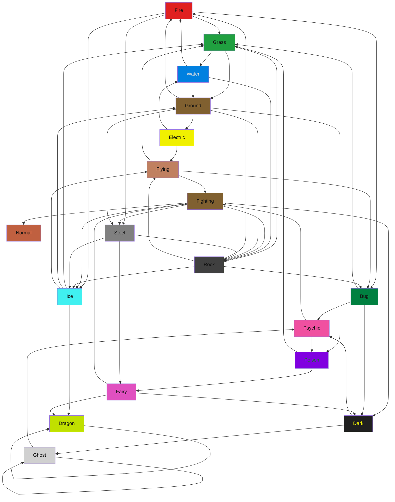

## Types Chart

| A \ D  | Normal |  Fire  | Grass  | Water  | Electric |  Ice   | Fighting | Poison | Ground | Flying | Psychic |  Bug   |  Rock  | Ghost  | Dragon |  Dark  | Steel  | Fairy  |
| ------ | ------ | ------ | ------ | ------ | ------ | ------ | ------ | ------ | ------ | ------ | ------ | ------ | ------ | ------ | ------ | ------ | ------ | ------ |
| Normal |   .    |   .    |   .    |   .    |   .    |   .    |   .    |   .    |   .    |   .    |   .    |   .    |   .    |   .    |   .    |   .    |   .    |   .    |
|  Fire  |   .    |   .    |   X    |   .    |   .    |   X    |   .    |   .    |   .    |   .    |   .    |   X    |   .    |   .    |   .    |   .    |   X    |   .    |
| Grass  |   .    |   .    |   .    |   X    |   .    |   .    |   .    |   .    |   X    |   .    |   .    |   .    |   X    |   .    |   .    |   .    |   .    |   .    |
| Water  |   .    |   X    |   .    |   .    |   .    |   .    |   .    |   .    |   X    |   .    |   .    |   .    |   X    |   .    |   .    |   .    |   .    |   .    |
| Electric |   .    |   .    |   .    |   X    |   .    |   .    |   .    |   .    |   .    |   X    |   .    |   .    |   .    |   .    |   .    |   .    |   .    |   .    |
|  Ice   |   .    |   .    |   X    |   .    |   .    |   .    |   .    |   .    |   X    |   X    |   .    |   .    |   .    |   .    |   X    |   .    |   .    |   .    |
| Fighting |   X    |   .    |   .    |   .    |   .    |   X    |   .    |   .    |   .    |   .    |   .    |   .    |   X    |   .    |   .    |   X    |   X    |   .    |
| Poison |   .    |   .    |   X    |   .    |   .    |   .    |   .    |   .    |   .    |   .    |   .    |   .    |   .    |   .    |   .    |   .    |   .    |   X    |
| Ground |   .    |   X    |   .    |   .    |   X    |   .    |   .    |   X    |   .    |   .    |   .    |   .    |   X    |   .    |   .    |   .    |   X    |   .    |
| Flying |   .    |   .    |   X    |   .    |   .    |   .    |   X    |   .    |   .    |   .    |   .    |   X    |   .    |   .    |   .    |   .    |   .    |   .    |
| Psychic |   .    |   .    |   .    |   .    |   .    |   .    |   X    |   X    |   .    |   .    |   .    |   .    |   .    |   .    |   .    |   .    |   .    |   .    |
|  Bug   |   .    |   .    |   X    |   .    |   .    |   .    |   .    |   .    |   .    |   .    |   X    |   .    |   .    |   .    |   .    |   X    |   .    |   .    |
|  Rock  |   .    |   X    |   .    |   .    |   .    |   X    |   .    |   .    |   .    |   X    |   .    |   X    |   .    |   .    |   .    |   .    |   .    |   .    |
| Ghost  |   .    |   .    |   .    |   .    |   .    |   .    |   .    |   .    |   .    |   .    |   X    |   .    |   .    |   X    |   .    |   .    |   .    |   .    |
| Dragon |   .    |   .    |   .    |   .    |   .    |   .    |   .    |   .    |   .    |   .    |   .    |   .    |   .    |   .    |   X    |   .    |   .    |   .    |
|  Dark  |   .    |   .    |   .    |   .    |   .    |   .    |   .    |   .    |   .    |   .    |   X    |   .    |   .    |   X    |   .    |   .    |   .    |   .    |
| Steel  |   .    |   .    |   .    |   .    |   .    |   X    |   .    |   .    |   .    |   .    |   .    |   .    |   X    |   .    |   .    |   .    |   .    |   X    |
| Fairy  |   .    |   .    |   .    |   .    |   .    |   .    |   X    |   .    |   .    |   .    |   .    |   .    |   .    |   .    |   X    |   X    |   .    |   .    |

## Type Stats

| Type | Weak To (Incoming) | Strong Against (Outgoing) | 3-Type Cycles |
| :--- | :--- | :--- | :---: |
| **`Normal`** | `Fighting` (1) | *(None)* (0) | **0** |
| **`Fire`** | `Water`, `Ground`, `Rock` (3) | `Grass`, `Ice`, `Bug`, `Steel` (4) | **5** |
| **`Grass`** | `Fire`, `Ice`, `Poison`, `Flying`, `Bug` (5) | `Water`, `Ground`, `Rock` (3) | **7** |
| **`Water`** | `Grass`, `Electric` (2) | `Fire`, `Ground`, `Rock` (3) | **2** |
| **`Electric`** | `Ground` (1) | `Water`, `Flying` (2) | **1** |
| **`Ice`** | `Fire`, `Fighting`, `Rock`, `Steel` (4) | `Grass`, `Ground`, `Flying`, `Dragon` (4) | **5** |
| **`Fighting`** | `Flying`, `Psychic`, `Fairy` (3) | `Normal`, `Ice`, `Rock`, `Dark`, `Steel` (5) | **4** |
| **`Poison`** | `Ground`, `Psychic` (2) | `Grass`, `Fairy` (2) | **1** |
| **`Ground`** | `Grass`, `Water`, `Ice` (3) | `Fire`, `Electric`, `Poison`, `Rock`, `Steel` (5) | **6** |
| **`Flying`** | `Electric`, `Ice`, `Rock` (3) | `Grass`, `Fighting`, `Bug` (3) | **3** |
| **`Psychic`** | `Bug`, `Ghost`, `Dark` (3) | `Fighting`, `Poison` (2) | **1** |
| **`Bug`** | `Fire`, `Flying`, `Rock` (3) | `Grass`, `Psychic`, `Dark` (3) | **1** |
| **`Rock`** | `Grass`, `Water`, `Fighting`, `Ground`, `Steel` (5) | `Fire`, `Ice`, `Flying`, `Bug` (4) | **7** |
| **`Ghost`** | `Ghost`, `Dark` (2) | `Psychic`, `Ghost` (2) | **0** |
| **`Dragon`** | `Ice`, `Dragon`, `Fairy` (3) | `Dragon` (1) | **0** |
| **`Dark`** | `Fighting`, `Bug`, `Fairy` (3) | `Psychic`, `Ghost` (2) | **1** |
| **`Steel`** | `Fire`, `Fighting`, `Ground` (3) | `Ice`, `Rock`, `Fairy` (3) | **3** |
| **`Fairy`** | `Poison`, `Steel` (2) | `Fighting`, `Dragon`, `Dark` (3) | **1** |

## Type Cycles

Found 16 3-type cycles:

- Fire -> Grass -> Water -> Fire
- Fire -> Grass -> Ground -> Fire
- Fire -> Grass -> Rock -> Fire
- Fire -> Ice -> Ground -> Fire
- Fire -> Steel -> Rock -> Fire
- Grass -> Ground -> Poison -> Grass
- Grass -> Rock -> Ice -> Grass
- Grass -> Rock -> Flying -> Grass
- Grass -> Rock -> Bug -> Grass
- Water -> Ground -> Electric -> Water
- Ice -> Ground -> Rock -> Ice
- Ice -> Ground -> Steel -> Ice
- Ice -> Flying -> Fighting -> Ice
- Fighting -> Rock -> Flying -> Fighting
- Fighting -> Dark -> Psychic -> Fighting
- Fighting -> Steel -> Fairy -> Fighting
